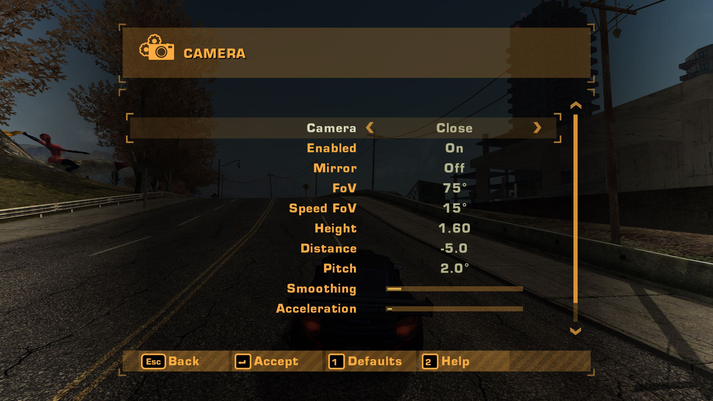

# Camera Settings

This mod for Need for Speed: Most Wanted 2005 (1.3) lets you tune camera views in the pause/main menu.

[YouTube link.](https://www.youtube.com/watch?v=busbD-FejdI)

This mod is now considered finished.

## Mod Compatibility

- See [General Compatibility](../../ReadMe.md#general-compatibility).
- Required: [Custom Menus](../custom_menus/ReadMe.md). Otherwise all the customization options won't appear.
- Confirmed compatible:
  - "DRIFT" and "Pursuit" camera modes added by [`NFSMWExtraOptions`](https://github.com/ExOptsTeam/NFSMWExOpts).
- This mod will force `ForceEnableMirror = 0` in the [NFSMWHDReflections](https://github.com/sniten/NFSMWHDReflections) mod, since the mirror can now be toggled per-camera instead.

## Camera Settings

It was my goal to integrate this mod into the original game's design as if it was a native feature that shipped with the game:

- Separate customization for each camera type, including additional cameras added by other mods. Each camera view has the following options:
  - FoV, Height, Forward/Backward Distance.
  - Smoothing: Reduce this to make the camera stick to the car more, but it will also be a bit more shaky.
  - Tilt: How much the camera tilts with the car.
  - Acceleration: How much the camera's forward/backward distance reacts to acceleration and braking.
  - Speed FoV: Additional FoV / "vertigo effect" based on your speed. This behaviour is not present in the vanilla game.
  - Mirror: Whether a rear-view mirror is visible in this view. (The vanilla game's "Player -> Rearview Mirror" option is removed.)
  - Enabled: Whether this camera view is used by the Next/Previous Camera View hotkeys.
- You can hold Shift or LB to change values with smaller increments.
- In a split screen game ([Split Screen Support](../split_screen_support/ReadMe.md), up to 4 players) the settings are the same for every player: each player's camera is the game's own, so each player's current view (Change Camera View) gets them.
- Cycling cameras: The mod renames the vanilla game's "Change Camera View" keybind to **"Next Camera View"** and adds a **Previous Camera View** counterpart.
- Values are applied as offsets:
  - In the game, every car has base camera positions for each camera view. This is preserved by applying your customizations as an offset.
  - This does mean that the displayed camera values can change when you change cars. This is working as intended. The same offsets were applied to a different base, and the final value is displayed.
  - This also means we must pick a base car to use when displaying the camera settings in the main menu. For this, we arbitrarily picked the BMW M3 GTR.
- Native UX:
  - A custom hand-made icon for the menu.
  - Hit **Apply** to save. Otherwise, hitting **Back** will ask if you want to discard your changes.
  - A button to reset to defaults.
  - A help button that explains what each setting does.
  - Controller input tested and fully supported.

### AI Disclaimer

The code was written by Claude (Sonnet & Opus). The custom menu icon, testing, design, and this page, were hand-made.
