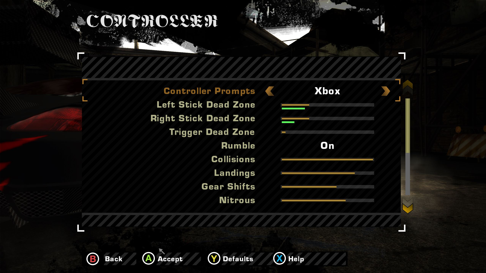

# Controller Support

This mod for Need for Speed: Most Wanted 2005 (1.3) gives full controller support including analogue steering and throttle, camera look while driving, input remapping, customizable rumble, complete menu navigation, different button prompt styles (Xbox/PlayStation/Switch), customizable deadzones.

[YouTube link.](https://www.youtube.com/watch?v=dkV51odPfAY)

This mod is now considered finished.

## Download
Download from the [Releases](../../../../releases) page.

## Mod Compatibility
- See [General Compatibility](../../ReadMe.md#general-compatibility).
- Recommended: [Custom Menus](../custom_menus/ReadMe.md) mod if you want to customize rumble, deadzones, button prompts, or camera look keybindings.
- WideScreenFix: `ImproveGamepadSupport = 0` will be forced by this mod for compatibility.
- Incompatible: `NFS-XtendedInput`, potentially other similar mods that mess with controller functions.

## Controller Compatibility
- XInput controllers (xbox controllers and many 3rd-party controllers) are supported with or without SteamInput.
- Other controllers like PS5 and Switch are supported via Steam Input. To use Steam Input, add `speed.exe` to your Steam Library as a non-Steam game, and then **right click->Properties->Controller->Set "Enable Steam Input" instead of "Use default Settings"**. This is not Steam's default as of 2026 October, you have to do this yourself.
- PS5 controller was tested fully working, including rumble, deadzone customization, and automatically using PS5 button prompts.
- Nintendo Switch Pro controller also tested and fully working. Steam Input will by default map Nintendo Switch buttons in a way that supports the muscle memory of Nintendo gamers. If your Switch controller is to be used by a gamer who grew up with Xbox or Playstation, you should do two things: 1) In Steam Input, swap the mapping of X/Y and A/B. 2) In the game, set the controller's Prompt Style from "Switch (Nintendo Layout)" to just "Switch". Then your Switch controller will have the same button positions as an Xbox or PS controller.
- Gyro controls: Tested with Steam Input, it worked with the Switch Pro but not with the DualSense 5. Makes menu navigation annoying, since there's no way to differentiate gyro inputs from regular ones. Unless I make it so that the menu cna only be navigated with the d-pad, but it would be a hassle and I think the gyro is gimmicky so I didn't bother.

## Car Controls

- **Analog steering, gas and brake**: The vanilla game maps them as on/off inputs, so even a stick bound to them was not analog. This mod enables analog throttle and reversing.
- Better default controller bindings. They can also be fully remapped in the game's controls menu, which will show accurate and precise button names.
- **Independent Triggers**: In the vanilla game, both triggers share one axis, so gas and brake on the triggers cancel each other. With this mod, you can hold gas and brake at the same time, just like you can on keyboard, causing a burnout.

## Better Defaults
The vanilla game's default keybindings don't use the analogue triggers for throttle and braking, and the Nitro button is the Start button, which is a bit ridiculous. I decided to completely ignore the game's default controller keybindings and completely overhaul them. Of course, they are still fully remappable. The better defaults can be disabled in the .ini.

## Camera look
- All 3rd-person car cameras can be controlled with either the mouse, or the right stick (in a split screen race the mouse is the camera of the player who plays on the keyboard, and of nobody if everybody plays on a controller)
- The latter is remappable in the Controls menu, if [Custom Menus](../custom_menus/ReadMe.md) is installed.
- After letting go of the "Look" inputs for a few seconds, the camera returns to its default position. With [Custom Menus](../custom_menus/ReadMe.md) installed, **Options > Player > Free Look Reset** sets how many seconds that takes for each player, or Off to leave the camera where you put it.
- Free look also works in the Look Behind view.

## Customizable Rumble
Note that any controller with a low battery will fail to rumble due to the physics of motors and batteries. If you're not getting rumble, always check battery first.
- Various events in-game will create controller rumble, such as gear shifts, collisions, driving on grass, nitrous, and more.
- The rumble strength of each type of event can be cutomized per controller in **Options > Controls > a controller > Settings**, if [Custom Menus](../custom_menus/ReadMe.md) is installed.

## Customizable Dead-zones
- You can change the deadzone of each stick, and the triggers, in the same menu as the Rumble settings mentioned above.
- The green bar under each dead zone slider shows the current activation value of the given stick/trigger. I recommend calibrating the deadzone by gently nudging the stick in all directions, letting go, and taking note of the highest value that the green bar can reach while not being touched.

## Several controllers
- With more than one controller connected, each controller can be customized. Their dead zones, rumble, and button mappings are stored per savefile.
- In single-player, all input devices (keyboard and all controllers) can control the game at the same time.
- Controller settings are stored per controller identity, as long as it has one. This ID is defined by the OS, and it can be defined by connecting USB port instead of actual device hardware ID. Through Steam Input every controller looks the same to the game, but Steam tells us which real controller is behind each one, so such a controller is identified by its model (Xbox One S, DualSense, ...); two of the same model are told apart by their order. A controller that can't be identified at all is stored per controller slot, 1 to 4.
- Controllers can be connected while the game is running, no need to restart like in vanilla.
- This mod fully integrates with my [Split Screen Support](../split_screen_support/ReadMe.md) mod, so everything will work like you would expect from a video game that has split screen: Both players can pause the game, control the menus, control their own cameras, have their own controller customization as described above.

## Menu Navigation
- Menu navigation tested in all menus I could think of, including obscure menus like Showroom, Blacklist bio screen, Advanced Video Settings.
- Automatically switch to controller button prompts as soon as controller input is detected, and vice versa.
- The Controls menu shows each controller's real name when it is known ("DualSense Wireless Controller"), and a controller starts with the button prompts of its kind (PlayStation prompts for a DualSense) until you choose otherwise.
- Button prompts show Xbox buttons for a controller of unknown kind. Each controller has its own prompt style: if [Custom Menus](../custom_menus/ReadMe.md) is installed, you can switch a controller to PlayStation or Nintendo Switch button prompts via **Options > Controls > the controller > Settings > Controller Prompts**, and the prompts follow whichever controller you touched last.
- The Controls menu keeps your changed bindings without asking, both when you leave it and when you switch controller (the game only asked in the second case). `confirm_keybinds=1` in the .ini asks in both cases instead (Yes keeps the changes, No puts the old bindings back).
- The world map can be panned with the right stick, and zoomed with the shoulder buttons/triggers.
- In the showroom, the triggers zoom the car view smoothly instead of stepped zoom levels.

### Translations
- The texts this mod adds to the UI (via the [Custom Menus](../custom_menus/ReadMe.md) mod), such as the Settings page, the camera look input mappings, and the controller button names, are translated into the game's nine other PC languages.

### AI Disclaimer

The code was written by Claude (Sonnet & Opus). Testing, design, and this page, were hand-made.
